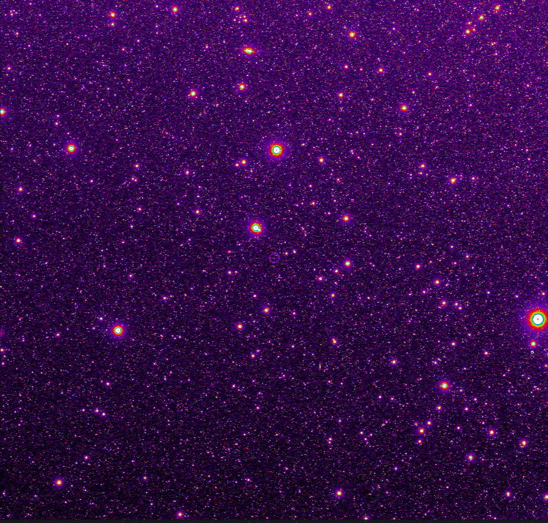
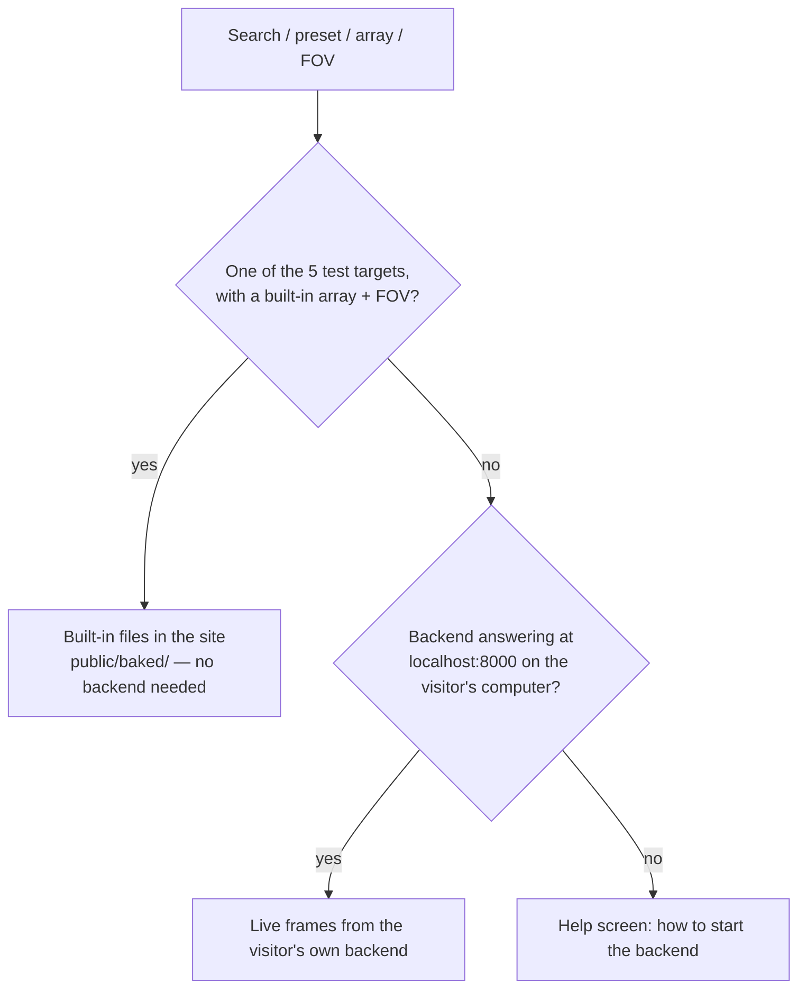
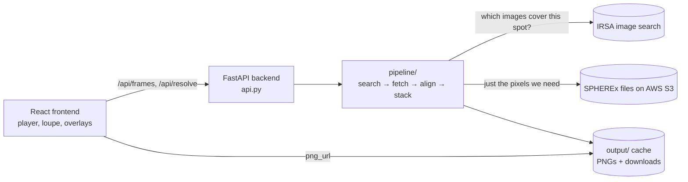

<!-- Hero -->
<h1 align="center">🔭 Minion Yuri – SPHEREx Blink</h1>

<p align="center"><b>🚀 In honour of Yuri Gagarin, the first human in space (12 April 1961). Поехали! ("Let's go!")</b></p>

<!-- Badges -->
<div align="center">
  
  <a href="https://github.com/rsinghSD/minion-yuri-SphereX/graphs/contributors">
    
  </a>
  <a href="https://github.com/rsinghSD/minion-yuri-SphereX/pulls">
    
  </a>
  <a href="https://github.com/rsinghSD/minion-yuri-SphereX/commits/main">
    
  </a>
</div>

<p align="center">
  
  <br/><sub>A patch of sky as seen by NASA's SPHEREx in infrared. Data: NASA/IPAC Infrared Science Archive (IRSA).</sub>
</p>

# What is Minion Yuri?

Minion Yuri is a public web tool for **NASA Space Apps 2026**. Anyone types sky
coordinates (or a name like *Barnard's Star*) and gets a **blinking animation of
SPHEREx images** of that patch of sky, so moving and changing objects stand out.

SPHEREx photographs the whole sky every six months in 102 colours (infrared
wavelengths). The motion we look for is tiny, often 1–2 pixels between visits,
so the whole product is built around making small changes visible: aligned
frames, a shared brightness scale, a zoom loupe and a difference view.

This README is for the team and anyone who wants to run the project locally.

Table of Contents
=================

- [What is Minion Yuri?](#what-is-minion-yuri)
  - [Tech Stack](#tech-stack)
  - [Repository Structure](#repository-structure)
  - [Getting Started](#getting-started)
    - [1. Run the backend](#1-run-the-backend)
    - [2. Run the frontend](#2-run-the-frontend)
    - [3. Connect the frontend to the backend](#3-connect-the-frontend-to-the-backend)
  - [The Public Site: Built-in Targets + Your Own Backend](#the-public-site-built-in-targets--your-own-backend)
  - [Deploy the Backend (Hugging Face)](#deploy-the-backend-hugging-face)
  - [How It Works](#how-it-works)
  - [API](#api)
  - [Features and Owners](#features-and-owners)
  - [Test Targets](#test-targets)
  - [Team](#team)
  - [Contribution Guidelines](#contribution-guidelines)
  - [Credits](#credits)
  - [Changelog](#changelog)

## Tech Stack
- 🖥️ **Frontend:** React (Create React App), JavaScript, CSS
- 🧠 **Backend:** Python, FastAPI, astropy, numpy, Pillow
- 🛰️ **Data:** SPHEREx images from NASA/IPAC IRSA (search via SIA2, pixels from IRSA's AWS S3 copy), names via CDS Sesame, Gaia DR3 for proper motions
- ☁️ **Hosting:** frontend on Vercel (https://stealingthemoon.earth) with the 5 test targets built in; backend runs on the visitor's own computer
- 📦 **Package management:** npm (frontend), pip + venv (backend)

## Repository Structure
```
- backend/                  # Python: all the astronomy, served as JSON + PNGs
  - api.py                  # FastAPI app: /api/resolve, /api/frames
  - bake.py                 # renders the 5 test targets into the frontend (public/baked/)
  - epochs.py               # command-line tool: PNG grid / GIF / FITS for a position
  - pipeline/               # the data pipeline, one file per step
    - search.py             # 1. find every SPHEREx exposure covering the position
    - fetch.py              # 2. download just the small square we need (AWS)
    - grid.py               # 3. align every square onto one north-up grid
    - stacks.py             # 4. group exposures into visits and stack -> get_stacks()
    - render.py             # PNGs for the browser
    - resolve.py            # names / coordinates -> RA, Dec (+ proper motion)
    - flags.py              # what each SPHEREx bad-pixel flag means
    - settings.py           # shared constants
  - requirements.txt
  - readme.md               # backend details: endpoints, JSON, how the pipeline works
  - output/                 # downloads + generated images (not in git)

- frontend/minion-yuri/     # React app
  - public/baked/           # the 5 test targets, pre-rendered by backend/bake.py
  - public/mock/frames.json # fake /api/frames answer for working offline
  - src/
    - api/frames.js         # the ONLY file that talks to the backend
    - data/target.js        # the 5 test targets
    - components/           # search, player, loupe, presets, ...
    - pages/                # About the data, How it works, Team
  - README.md               # frontend details: who owns which component

- deploy/
  - huggingface/            # Dockerfile, Space README and deploy.sh for the backend
  - precache.sh             # load the 5 presets once so they're cached on the server

- docs/                     # requirements doc, prep slides, images, changelog
```

## Getting Started

You need **Python 3.11+** and **Node.js 18+**. Run the backend and the frontend
in two terminals.

### 1. Run the backend

```bash
cd backend
python3 -m venv .venv                       # first time only
.venv/bin/pip install -r requirements.txt   # first time only
.venv/bin/uvicorn api:app --reload --port 8000
```

Check it works:
- http://localhost:8000/api/health should answer `{"ok": true}`
- http://localhost:8000/docs lets you try every endpoint in the browser

> [!tip]
> The first request for a new position takes **15–45 s** (it downloads from
> NASA's archive). The same request again takes **2–8 s**. Before a demo,
> open each preset once so it's cached.

### 2. Run the frontend

```bash
cd frontend/minion-yuri
npm install      # first time only
npm start
```

This opens http://localhost:3000 and talks to the backend at
`http://localhost:8000`, so start the backend first.

### 3. Connect the frontend to the backend

**They're already connected.** With the backend on port 8000 and `npm start`
running, the app loads real SPHEREx frames. All backend calls go through one
file: [`frontend/minion-yuri/src/api/frames.js`](frontend/minion-yuri/src/api/frames.js).

Settings live in `frontend/minion-yuri/.env.local` (copy
[`.env.example`](frontend/minion-yuri/.env.example)), and you restart `npm start`
after changing them:

| Setting | Default | Use it for |
|---|---|---|
| `REACT_APP_API_URL` | `http://localhost:8000` | The backend's address, e.g. the deployed backend |
| `REACT_APP_USE_MOCK` | `false` | `true` = use `public/mock/frames.json` instead of the backend (works offline) |

**What happens in the app:**

| You do | Frontend | Backend call |
|---|---|---|
| Open the page | Reads `?ra=&dec=&fov=&array=` from the URL (default: Barnard's Star, array 1) | `GET /api/frames` |
| Click a preset | Moves to that target **and** its best detector array | `GET /api/frames` |
| Search a preset name or decimal `RA, Dec` | Handled in the browser, instantly | `GET /api/frames` |
| Search any other name (`Vega`) or sexagesimal (`08h55m10.8s -07d14m42s`) | Asks the backend, uses today's position (`ra_now`/`dec_now`) | `GET /api/resolve`, then `GET /api/frames` |
| Click a detector array (1–6) or field of view (2/5/10/20/40′) | Reloads that view | `GET /api/frames` |

While loading, the player shows a spinner with a seconds counter, and explains
that a first visit to a spot can take up to a minute. If loading fails it
shows what went wrong and a **Try again** button. Changing the view while it
loads cancels the old request.

What the backend takes care of:
- **CORS is open**, so the browser lets `localhost:3000` call `localhost:8000`,
  and Jay's loupe can read pixel colours from the PNGs.
- **`png_url` is an absolute URL** (`http://localhost:8000/files/...`), so it
  works straight in ``.
- `date` is `YYYY-MM-DD`, the same format as the mock.

> [!note]
> **On a deployed site:** set `REACT_APP_API_URL` to the backend's public
> address when building the frontend, and start the backend with
> `PUBLIC_BASE_URL=https://<backend-address>` so PNG links point at the server
> instead of `localhost`.

**If something doesn't work:**

| Symptom | Cause | Fix |
|---|---|---|
| "Is the backend running at http://localhost:8000?" | Backend not running, or wrong `REACT_APP_API_URL` | Start the backend; check http://localhost:8000/api/health; click **Try again** |
| Spinner for 15–45 s | First request for that position | Normal; it's cached afterwards |
| 20′ / 40′ slower, or fewer exposures per frame | Bigger squares download more, and exposures where the target is near a detector edge can't fill them and are skipped | Normal. Barnard's Star at 40′: 391 px, 36 s first time, ~4 s cached, 13 of 60 exposures skipped |
| Error mentioning IRSA's image search | NASA's search is having a bad moment and this position was never searched | Wait a minute, click **Try again** |
| "No SPHEREx images for this patch on this detector array" | Every exposure there was cut off by a detector edge, or none exist | Try another array or a smaller field of view |
| Changes to `.env.local` don't apply | CRA reads it only at start | Restart `npm start` |
| A preset suddenly takes 30 s again | Its downloads in `backend/output/` were removed | Normal once; see the warning below |

> [!warning]
> Switching to an **old** commit where `backend/output/` was still tracked in git,
> then back, makes git delete those files, including the downloads, so presets
> load slowly once more. Since PR #5 `output/` is ignored, so this only happens
> when you go back to older commits.

## The Public Site: Built-in Targets + Your Own Backend

The frontend is live at **https://stealingthemoon.earth** (Vercel, built from
GitHub). There is no hosted backend (free hosts paused or charged for it), so
the site gets its data in two ways:



**1. The 5 test targets are built in.** `backend/bake.py` renders them into
`frontend/minion-yuri/public/baked/`, and they deploy with the site:
- every detector array (1–6) at 2′, 5′ and 10′
- each target's own (best) array also at 20′ and 40′

```bash
cd backend
.venv/bin/python bake.py                # all 5; re-run when target.js changes
.venv/bin/python bake.py "WISE 0855"    # just one
```
Then commit `frontend/minion-yuri/public/baked/` and push; Vercel redeploys.
`bake.py` reads the targets from `src/data/target.js`, so the two can't drift.

**2. Anything else needs the visitor's own backend.** The public page calls
`http://localhost:8000` from the visitor's browser, so it reaches **their** computer.
If nothing answers, the site shows the three commands to clone, install and
start the backend, then a **Try again** button. This works because:
- the backend allows any site to call it (CORS) and answers Chrome's
  local-network check (`allow_private_network`), so Chrome may show a
  "this site wants to access your local network" prompt: click **Allow**;
- browsers treat `http://localhost` as safe, so an `https://` page may call it.
  **Safari blocks this**; use Chrome or Firefox.

**Use a different backend** (a teammate's laptop through a tunnel, a hosted one):
open the site with `?api=` and it's remembered in that browser:
```
https://stealingthemoon.earth/?api=https://some-backend.example.com
https://stealingthemoon.earth/?api=default        # back to localhost:8000
```
Or set `REACT_APP_API_URL` in Vercel's environment variables to change the
default for everyone.

## Deploy the Backend (Hugging Face)

> [!warning]
> On our account, Hugging Face paused the Space: the free CPU quota was used
> up. Kept here in case a teammate's account has quota left. The site works
> without it (see above).

The backend runs as a free **Hugging Face Space** using Docker. A Space is its
own git repo on huggingface.co; `deploy.sh` copies just the backend into it,
and Hugging Face builds and runs the container.

**Once: create the Space**
1. Sign in at https://huggingface.co → **New Space**.
2. Name it (e.g. `minion-yuri-api`), choose **Docker** → **Blank**, hardware
   **CPU basic (free)**, visibility **Public**.
3. Create an access token with **Write** permission at
   https://huggingface.co/settings/tokens.

**Once: your settings.** Fill in `deploy/.env` (copy
[`deploy/.env.example`](deploy/.env.example) if it's missing):

```
HF_USERNAME=<your hf username>
HF_SPACE=<your hf username>/minion-yuri-api
HF_TOKEN=<your WRITE token>
BACKEND_URL=            # leave empty for https://<user>-minion-yuri-api.hf.space
```

`deploy/.env` is **git-ignored**: never commit or share it. Hugging Face no
longer accepts your account password for git, so the token is what logs you in.
The scripts hand it to git without printing it or saving it anywhere else.

**Every deploy**
```bash
deploy/huggingface/deploy.sh
```
(or `deploy/huggingface/deploy.sh <hf-user>/<space>` to deploy somewhere else;
without `HF_TOKEN`, git asks for your username and the token as password).
The build takes a few minutes; follow it in the Space's **Logs** tab. The
backend is then live at `https://<hf-user>-minion-yuri-api.hf.space`:
- `/api/health` should answer `{"ok": true}`
- `/` opens the interactive API docs

**After every deploy or wake-up: pre-cache the presets**
```bash
deploy/precache.sh            # backend URL comes from deploy/.env
```
Run it twice; the second run should take a few seconds per preset (F8: under 10 s).

**Point the frontend at it:** build the frontend with
`REACT_APP_API_URL=https://<hf-user>-minion-yuri-api.hf.space`.

> [!note]
> - **No extra settings needed.** The container trusts Hugging Face's HTTPS
>   proxy, so PNG links come out as `https://<space>.hf.space/files/...`.
>   `PUBLIC_BASE_URL` (a Space variable) is only needed for a custom domain.
> - **Free Spaces sleep** after a period without visitors. The first request
>   after that wakes it (about a minute) and the cache starts empty, so open the
>   Space and re-run `precache.sh` before a demo.
> - **The cache isn't permanent**: it lives in the container and is wiped by a
>   restart or redeploy. Downloads are re-made on demand.

## How It Works



1. **Search.** IRSA lists every SPHEREx exposure containing the position, on
   each of SPHEREx's 6 detector arrays (D1 short wavelength … D6 long).
2. **Download a small square.** Instead of each 65 MB file, we fetch only the
   detector rows around the position (~0.3 MB) from IRSA's copy on AWS.
3. **Align.** Every exposure sees the sky at a different angle, so each square is
   resampled onto one shared grid: north up, centred on the position.
4. **Stack per visit.** SPHEREx visits each patch for a few days every ~6
   months. Exposures from one visit are combined into one clean frame, with
   cosmic rays and bad pixels removed.
5. **One brightness scale.** All frames of an array use the same scale, so a
   steady star looks the same in every frame (it varies only ~3–4%). Only real
   changes blink.

More detail: [backend/readme.md](backend/readme.md).

## API

| Endpoint | What it does |
|---|---|
| `GET /api/frames?ra=&dec=&fov=&array=` | Aligned, stacked frames of one patch on one detector array: `{ array, wavelength_um, epochs: [{ date, n_exposures, png_url, flags_png_url }] }` |
| `GET /api/resolve?name=` | Name, decimal or sexagesimal coordinates → `{ ra, dec, pm_ra_mas_yr, pm_dec_mas_yr, ra_now, dec_now }` |
| `GET /api/health` | `{ ok: true }` |
| `GET /api/spectrum?ra=&dec=` | *Planned (Shoya, F12)* |

Units: RA/Dec in decimal degrees, FOV in arcminutes, array 1–6 (short → long
wavelength). Full JSON examples and extra fields: [backend/readme.md](backend/readme.md).

## Features and Owners

From the [requirements doc](docs/). A feature counts as **done** when its check
passes on the **deployed** site, not just locally.

| Priority | Feature | ID | Owner | Status |
|---|---|---|---|---|
| Must | Coordinate search + field of view | F1, F2 | Sam (UI), Raman (`/api/resolve`) | Works locally with the real API (names, decimal, sexagesimal) |
| Must | Blink player (1–2 fps, slider, play/pause) | F4 | Sam | Works locally with real frames |
| Must | Detector-array selector, stacked per visit | F3, F5 | Raman | Works locally: array buttons 1–6 in the app |
| Must | Zoom loupe on the target | F6 | Jay | Works locally on real frames |
| Must | Shareable URL with coordinates | F7 | Sam | Works locally (`?ra=&dec=&fov=&array=`) |
| Must | One-click presets for the 5 test targets | F8 | Sam + Axe (cache) | Work locally; server pre-cache to do |
| Should | Difference mode (new minus old) | F9 | Jay | |
| Should | Wavelength scrubber / false-colour RGB | F10 | Shoya | |
| Should | Predicted Gaia track overlay | F11 | Jay + Shoya | |
| Could | Click a pixel → spectrum | F12 | Shoya | |
| Could | Flags overlay | F13 | first free | Backend ready (`flags_png_url`) |
| Could | GIF export | F14 | first free | |
| Could | "Spot the mover" game | F15 | first free | |

## Test Targets

<p align="center">
  
  <br/><sub>The 5 test targets as the backend serves them: one row per target, one frame per SPHEREx visit.</sub>
</p>

Each target shows off a different feature. Fast-moving stars have moved since
their catalogue (year 2000) position, so presets should use **today's position**
(`ra_now`/`dec_now` from `/api/resolve`).

| Target | Shows off | Today's position (RA, Dec) | Best array | Visits found |
|---|---|---|---|---|
| Barnard's Star | Loupe, difference mode, Gaia track | 269.446074, 4.770708 | D1 | 4 |
| WISE 0855 | Wavelength view (only visible at long wavelengths) | 133.757786, −7.242023 | D6 | 5 |
| Epsilon Indi B | Flags overlay (glare near a bright star) | 331.098400, −56.801256 | D3 | 7 |
| RW Aurigae | Blink player, spectrum (variable star) | 76.956526, 30.401438 | D3 | 3 |
| R Draconis | Blink player (variable star, many visits) | 248.167611, 66.754979 | D3 | 7 |

These positions and arrays are what the presets in
[`src/data/target.js`](frontend/minion-yuri/src/data/target.js) use. (Before,
the Epsilon Indi B preset pointed roughly at Epsilon Indi **A**, about 7′
away.) The backend caches per exact position, so pre-cache these exact numbers
on the server.

## Team

| Role | Who | Owns |
|---|---|---|
| Data pipeline + team owner | Raman (Bamba) | F3, F5, `/api/resolve`, scope calls |
| Backend API, cache and display | Axe | `/api/frames`, cache, API contract, F8 pre-cache |
| Frontend: player | Sam (Muubi) | F1, F2, F4, F7, F8, phone layout |
| Frontend: making motion visible | Jay (Jelly) | F6, F9, F11 overlay |
| Science features + deploy | Shoya (Trappist) | F10, F11 Gaia, F12, `/api/spectrum`, hosting |
| Science lead + pitch | Yash (Dub) | Science specs, QA, demo, write-up |

## Contribution Guidelines

- **Branch per feature.** Branch off `main`, work there, and open a pull request.
  Pull `main` into your branch before asking for a review.
- **Merge only when it works against the API contract.** Don't break `main`.
- **PR description:** a title, then *What works now*, *Ready for others*
  (what teammates can now use) and *Note* (gaps, known issues).
- **Frontend:** components never fetch; everything goes through `src/api/frames.js`.
- **Backend:** the frontend never sees FITS files, only JSON and PNGs.
- **Don't commit data.** `backend/output/` and `.venv/` are git-ignored.
- **Blocked for 30+ minutes?** Say so in the group chat.

## Easter Egg 🕹️

Type **↑ ↑ ↓ ↓ ← → ← → B A Enter** anywhere on the site (not inside the search
box) and see what happens. Esc to get back to work.

## Credits

- This research has made use of the **NASA/IPAC Infrared Science Archive (IRSA)**,
  which is funded by NASA and operated by the California Institute of
  Technology. SPHEREx data are from IRSA. See IRSA's SPHEREx pages for the
  exact acknowledgement text required.
- This work has made use of data from the European Space Agency (ESA) mission
  **Gaia** (https://www.cosmos.esa.int/gaia), processed by the Gaia Data
  Processing and Analysis Consortium (DPAC).
- Name lookup by **CDS Sesame** (SIMBAD, NED, VizieR), Strasbourg Astronomical
  Observatory, France.
- Built with astropy, numpy, FastAPI and React.

## Changelog

What changed and when: [docs/changelog.md](docs/changelog.md).
