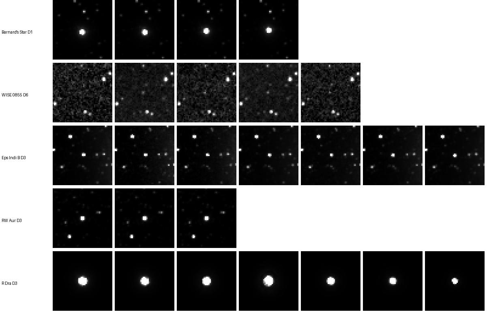
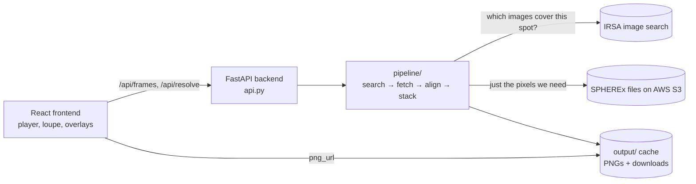

<!-- Hero -->
<h1 align="center">🔭 Minion Yuri – SPHEREx Blink</h1>

<p align="center"><b>Type a spot on the sky. Watch it blink through time. Spot what moves.</b></p>

<!-- Badges -->
<div align="center">
  
  <a href="https://github.com/rsinghSD/minion-yuri-SphereX/graphs/contributors">
    
  </a>
  <a href="https://github.com/rsinghSD/minion-yuri-SphereX/pulls">
    
  </a>
  <a href="https://github.com/rsinghSD/minion-yuri-SphereX/commits/main">
    
  </a>
</div>

<p align="center">
  
  <br/><sub>The 5 test targets as the backend serves them: one row per target, one frame per SPHEREx visit.</sub>
</p>

# What is Minion Yuri?

Minion Yuri is a public web tool for **NASA Space Apps 2026**. Anyone types sky
coordinates (or a name like *Barnard's Star*) and gets a **blinking animation of
SPHEREx images** of that patch of sky, so moving and changing objects stand out.

SPHEREx photographs the whole sky every six months in 102 colours (infrared
wavelengths). The motion we look for is tiny, often 1–2 pixels between visits,
so the whole product is built around making small changes visible: aligned
frames, a shared brightness scale, a zoom loupe and a difference view.

This README is for the team and anyone who wants to run the project locally.

Table of Contents
=================

- [What is Minion Yuri?](#what-is-minion-yuri)
  - [Tech Stack](#tech-stack)
  - [Repository Structure](#repository-structure)
  - [Getting Started](#getting-started)
    - [1. Run the backend](#1-run-the-backend)
    - [2. Run the frontend](#2-run-the-frontend)
    - [3. Connect the frontend to the backend](#3-connect-the-frontend-to-the-backend)
  - [How It Works](#how-it-works)
  - [API](#api)
  - [Features and Owners](#features-and-owners)
  - [Test Targets](#test-targets)
  - [Team](#team)
  - [Contribution Guidelines](#contribution-guidelines)
  - [Credits](#credits)
  - [Changelog](#changelog)

## Tech Stack
- 🖥️ **Frontend:** React (Create React App), JavaScript, CSS
- 🧠 **Backend:** Python, FastAPI, astropy, numpy, Pillow
- 🛰️ **Data:** SPHEREx images from NASA/IPAC IRSA (search via SIA2, pixels from IRSA's AWS S3 copy), names via CDS Sesame, Gaia DR3 for proper motions
- ☁️ **Hosting:** free tier for both apps (to be picked, see [Team](#team))
- 📦 **Package management:** npm (frontend), pip + venv (backend)

## Repository Structure
```
- backend/                  # Python: all the astronomy, served as JSON + PNGs
  - api.py                  # FastAPI app: /api/resolve, /api/frames
  - epochs.py               # command-line tool: PNG grid / GIF / FITS for a position
  - pipeline/               # the data pipeline, one file per step
    - search.py             # 1. find every SPHEREx exposure covering the position
    - fetch.py              # 2. download just the small square we need (AWS)
    - grid.py               # 3. align every square onto one north-up grid
    - stacks.py             # 4. group exposures into visits and stack -> get_stacks()
    - render.py             # PNGs for the browser
    - resolve.py            # names / coordinates -> RA, Dec (+ proper motion)
    - flags.py              # what each SPHEREx bad-pixel flag means
    - settings.py           # shared constants
  - requirements.txt
  - readme.md               # backend details: endpoints, JSON, how the pipeline works
  - output/                 # downloads + generated images (not in git)

- frontend/minion-yuri/     # React app
  - public/mock/frames.json # fake /api/frames answer for working offline
  - src/
    - api/frames.js         # the ONLY file that talks to the backend
    - data/target.js        # the 5 test targets
    - components/           # search, player, loupe, presets, ...
    - pages/                # About the data, How it works, Team
  - README.md               # frontend details: who owns which component

- docs/                     # requirements doc, prep slides, images, changelog
```

## Getting Started

You need **Python 3.11+** and **Node.js 18+**. Run the backend and the frontend
in two terminals.

### 1. Run the backend

```bash
cd backend
python3 -m venv .venv                       # first time only
.venv/bin/pip install -r requirements.txt   # first time only
.venv/bin/uvicorn api:app --reload --port 8000
```

Check it works:
- http://localhost:8000/api/health should answer `{"ok": true}`
- http://localhost:8000/docs lets you try every endpoint in the browser

> [!tip]
> The first request for a new position takes **15–45 s** (it downloads from
> NASA's archive). The same request again takes **2–8 s**. Before a demo,
> open each preset once so it's cached.

### 2. Run the frontend

```bash
cd frontend/minion-yuri
npm install      # first time only
npm start
```

This opens http://localhost:3000. Out of the box it shows **mock data** from
`public/mock/frames.json`, so the frontend works even without the backend.

### 3. Connect the frontend to the backend

All backend calls go through one file:
[`frontend/minion-yuri/src/api/frames.js`](frontend/minion-yuri/src/api/frames.js).

1. Start the backend on port 8000 (step 1).
2. In `src/api/frames.js`, set `USE_MOCK = false`. `API_URL` already points at
   `http://localhost:8000`.
3. Start the frontend (step 2) and click a preset. Frames now come from the real API.

What the backend already takes care of:
- **CORS is open**, so the browser lets `localhost:3000` call `localhost:8000`.
- **`png_url` is an absolute URL** (`http://localhost:8000/files/...`), so it
  works straight in ``.
- `date` is `YYYY-MM-DD`, the same format as the mock.

> [!note]
> **On a deployed site:** set `API_URL` to the backend's public address, and
> start the backend with `PUBLIC_BASE_URL=https://<backend-address>` so PNG links
> point at the server instead of `localhost`.

**If something doesn't work:**

| Symptom | Cause | Fix |
|---|---|---|
| "Could not load the sky images." | Backend not running, or wrong `API_URL` | Check http://localhost:8000/api/health |
| Spinner for 15–45 s | First request for that position | Normal; it's cached afterwards |
| Error 503 | NASA's search (IRSA) is having a bad moment and this position was never searched | Try again in a minute |
| Star is off-centre | Fast-moving stars have moved since their catalogue date | Use `ra_now`/`dec_now` from `/api/resolve` (see [Test Targets](#test-targets)) |
| Images look tiny | PNGs are native SPHEREx pixels (49×49 for 5′) | Scale up in CSS with `image-rendering: pixelated` |

## How It Works



1. **Search.** IRSA lists every SPHEREx exposure containing the position, on
   each of SPHEREx's 6 detector arrays (D1 short wavelength … D6 long).
2. **Download a small square.** Instead of each 65 MB file, we fetch only the
   detector rows around the position (~0.3 MB) from IRSA's copy on AWS.
3. **Align.** Every exposure sees the sky at a different angle, so each square is
   resampled onto one shared grid: north up, centred on the position.
4. **Stack per visit.** SPHEREx visits each patch for a few days every ~6
   months. Exposures from one visit are combined into one clean frame, with
   cosmic rays and bad pixels removed.
5. **One brightness scale.** All frames of an array use the same scale, so a
   steady star looks the same in every frame (it varies only ~3–4%). Only real
   changes blink.

More detail: [backend/readme.md](backend/readme.md).

## API

| Endpoint | What it does |
|---|---|
| `GET /api/frames?ra=&dec=&fov=&array=` | Aligned, stacked frames of one patch on one detector array: `{ array, wavelength_um, epochs: [{ date, n_exposures, png_url, flags_png_url }] }` |
| `GET /api/resolve?name=` | Name, decimal or sexagesimal coordinates → `{ ra, dec, pm_ra_mas_yr, pm_dec_mas_yr, ra_now, dec_now }` |
| `GET /api/health` | `{ ok: true }` |
| `GET /api/spectrum?ra=&dec=` | *Planned (Shoya, F12)* |

Units: RA/Dec in decimal degrees, FOV in arcminutes, array 1–6 (short → long
wavelength). Full JSON examples and extra fields: [backend/readme.md](backend/readme.md).

## Features and Owners

From the [requirements doc](docs/). A feature counts as **done** when its check
passes on the **deployed** site, not just locally.

| Priority | Feature | ID | Owner | Status |
|---|---|---|---|---|
| Must | Coordinate search + field of view | F1, F2 | Sam (UI), Raman (`/api/resolve`) | Backend works locally; UI built on mock data |
| Must | Blink player (1–2 fps, slider, play/pause) | F4 | Sam | Built on mock data |
| Must | Detector-array selector, stacked per visit | F3, F5 | Raman | Backend works locally |
| Must | Zoom loupe on the target | F6 | Jay | Built |
| Must | Shareable URL with coordinates | F7 | Sam | Built |
| Must | One-click presets for the 5 test targets | F8 | Sam + Axe (cache) | Presets built; server pre-cache to do |
| Should | Difference mode (new minus old) | F9 | Jay | |
| Should | Wavelength scrubber / false-colour RGB | F10 | Shoya | |
| Should | Predicted Gaia track overlay | F11 | Jay + Shoya | |
| Could | Click a pixel → spectrum | F12 | Shoya | |
| Could | Flags overlay | F13 | first free | Backend ready (`flags_png_url`) |
| Could | GIF export | F14 | first free | |
| Could | "Spot the mover" game | F15 | first free | |

## Test Targets

Each target shows off a different feature. Fast-moving stars have moved since
their catalogue (year 2000) position, so presets should use **today's position**
(`ra_now`/`dec_now` from `/api/resolve`).

| Target | Shows off | Today's position (RA, Dec) | Best array | Visits found |
|---|---|---|---|---|
| Barnard's Star | Loupe, difference mode, Gaia track | 269.446074, 4.770708 | D1 | 4 |
| WISE 0855 | Wavelength view (only visible at long wavelengths) | 133.757786, −7.242023 | D6 | 5 |
| Epsilon Indi B | Flags overlay (glare near a bright star) | 331.098400, −56.801256 | D3 | 7 |
| RW Aurigae | Blink player, spectrum (variable star) | 76.956526, 30.401438 | D3 | 3 |
| R Draconis | Blink player (variable star, many visits) | 248.167611, 66.754979 | D3 | 7 |

> [!warning]
> The current Epsilon Indi B preset in `src/data/target.js` (330.84, −56.786)
> is roughly where Epsilon Indi **A** is, about 7′ away from B.

## Team

| Role | Who | Owns |
|---|---|---|
| Data pipeline + team owner | Raman (Bamba) | F3, F5, `/api/resolve`, scope calls |
| Backend API, cache and display | Axe | `/api/frames`, cache, API contract, F8 pre-cache |
| Frontend: player | Sam (Muubi) | F1, F2, F4, F7, F8, phone layout |
| Frontend: making motion visible | Jay (Jelly) | F6, F9, F11 overlay |
| Science features + deploy | Shoya (Trappist) | F10, F11 Gaia, F12, `/api/spectrum`, hosting |
| Science lead + pitch | Yash (Dub) | Science specs, QA, demo, write-up |

## Contribution Guidelines

- **Branch per feature.** Branch off `main`, work there, and open a pull request.
  Pull `main` into your branch before asking for a review.
- **Merge only when it works against the API contract.** Don't break `main`.
- **PR description:** a title, then *What works now*, *Ready for others*
  (what teammates can now use) and *Note* (gaps, known issues).
- **Frontend:** components never fetch; everything goes through `src/api/frames.js`.
- **Backend:** the frontend never sees FITS files, only JSON and PNGs.
- **Don't commit data.** `backend/output/` and `.venv/` are git-ignored.
- **Blocked for 30+ minutes?** Say so in the group chat.

## Credits

- This research has made use of the **NASA/IPAC Infrared Science Archive (IRSA)**,
  which is funded by NASA and operated by the California Institute of
  Technology. SPHEREx data are from IRSA. See IRSA's SPHEREx pages for the
  exact acknowledgement text required.
- This work has made use of data from the European Space Agency (ESA) mission
  **Gaia** (https://www.cosmos.esa.int/gaia), processed by the Gaia Data
  Processing and Analysis Consortium (DPAC).
- Name lookup by **CDS Sesame** (SIMBAD, NED, VizieR), Strasbourg Astronomical
  Observatory, France.
- Built with astropy, numpy, FastAPI and React.

## Changelog

What changed and when: [docs/changelog.md](docs/changelog.md).
